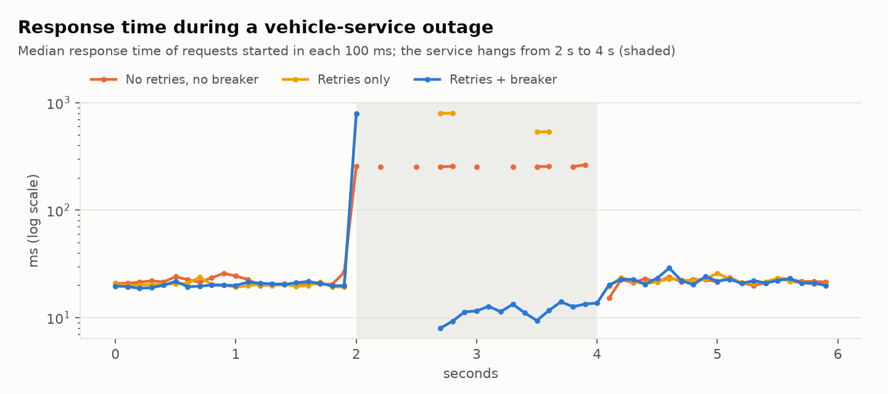

# partner-gateway

**An API gateway that lets outside partners (insurers, charging networks, fleet
managers) read data from connected vehicles and send them commands, without
having direct access to the vehicles.**

Partners call a REST API with OAuth 2.0 tokens. The gateway talks to the vehicle
service over **gRPC with mutual TLS** (or, on Cloud Run, TLS plus a Google ID token).
Commands complete asynchronously, their results flow back as **Pub/Sub events**, and
partners are notified through **signed webhooks**. Every external call is wrapped in rate
limits, deadlines, retries, a circuit breaker and idempotency keys. Every request is traced
and measured against SLOs.

The gateway keeps no state in its own process: rate limits and idempotency keys are in
**Redis**, partners, commands and the webhook outbox in **Postgres**, and signing keys come
from **Secret Manager**. Any number of replicas can run side by side, and a test runs two
against one Redis and one Postgres to prove the limits and the idempotency hold across them.
It deploys to **Cloud Run** with Memorystore and Cloud SQL from Terraform (`make deploy`).

```
                     OAuth 2.0 (client credentials, ES256 JWT, keys from Secret Manager)
 partner app ──REST──►┌──────────────── partner gateway (N replicas, stateless) ─────────────────┐
  (partner_sdk)       │ auth ─► rate limit ─► scope + vehicle grant ─► idempotency key             │
                      │           │                                        │                       │
                      │           └──────── Redis (token buckets, keys) ───┘                       │
                      │ deadline ─► retry (jittered) ─► circuit breaker                            │
                      │ commands, webhook outbox, partners ──► Postgres                            │
                      └───────────────────────────┬────────────────────────────────────────────────┘
        ▲                         gRPC + mTLS     │  (Cloud Run: TLS + ID token, IAM invoker)
        │                                         ▼
        │ signed webhook               ┌──── vehicle service ────┐     cars: simulated fleet,
        │ (HMAC, retries,              │ dedupe command ids      │◄──► or Smartcar API /
        │  dead letters, replay)       │ VehicleBackend          │     Smartcar Vehicle Simulator
        │                              └────────────┬────────────┘
        │                                           │ publish result
        └── gateway consumer (applies each result ◄─┘ Pub/Sub (or Redis Streams locally)
            once, across replicas)                    vehicle-command-results (+ dead letters)

 one trace across all hops (W3C traceparent in headers, gRPC metadata, message attributes)
 Prometheus metrics → SLOs → multi-window burn-rate alerts
```

> By default the vehicles are simulated (`pgw/vehicles/fleet.py`): they go online and offline,
> respond with variable latency, and fail commands the way cars do (charging an
> unplugged car). `PGW_VEHICLE_BACKEND=smartcar` swaps in the Smartcar API instead, which
> also drives Smartcar's hosted Vehicle Simulator. Everything between the partner and the
> car is the real implementation: tokens, gRPC, mTLS, Pub/Sub, webhooks, Redis, Postgres.

## What's in it

| Area | What's implemented |
|---|---|
| **Partner auth** | OAuth 2.0 client credentials. Secrets are stored only as scrypt hashes. Tokens are ES256 JWTs with `kid`. The algorithm is pinned (no `alg=none` or HS256 confusion). Scopes are `vehicles:read` and `vehicles:command`. |
| **Key rotation** | Signing keys are a key set loaded from an env var, a file or Secret Manager, reloaded every minute on every replica. Keys are staged in the JWKS before use and old keys verify until their tokens expire (`pgw keys stage/activate/prune`), so a rotation never rejects a valid token. |
| **Shared state** | Store interfaces with in-memory versions for tests. Redis: token buckets and idempotency keys as atomic Lua scripts. Postgres (SQLAlchemy 2, Alembic): partners, commands, webhook outbox; one-time transitions are single conditional `UPDATE`s, deliveries are claimed with `FOR UPDATE SKIP LOCKED` and a lease. |
| **Authorization** | Each partner sees only the VINs that owners granted it. Other VINs return 404, not 403, so a partner can't tell which vehicles exist. |
| **Service-to-service** | gRPC over mTLS with an internal CA. The vehicle service requires a client certificate and checks the caller's identity against an allow-list. |
| **Commands** | Accepted with `202`, run when the car is online (queued if it's offline), and expire if the car never reconnects. The vehicle service deduplicates command ids, so retries are safe. |
| **Events** | Pub/Sub topics with at-least-once delivery. Consumers are idempotent, and messages that keep failing go to a dead-letter topic. The bus is in-memory for tests, Google Cloud Pub/Sub (or its emulator) in GCP, and Redis Streams with consumer groups for the local multi-process stack. |
| **Webhooks** | HMAC-SHA256 signatures with timestamps, which block replays. Multiple signatures during secret rotation. Retries with backoff, dead letters, and a replay API. |
| **Resilience** | Per-partner token buckets with `Retry-After`, per-call deadlines, retries with jittered backoff inside an overall deadline, a circuit breaker with single-shot probes, and `Idempotency-Key` for commands. |
| **Observability** | OpenTelemetry traces from the partner's request to the webhook, Prometheus metrics labelled by route template, and SLOs with burn-rate alert rules generated from code. |
| **Partner SDK** | Caches and refreshes tokens, honors `Retry-After`, adds idempotency keys automatically, and verifies webhook signatures. |
| **Vehicles** | A `VehicleBackend` interface: the simulated fleet, or Smartcar (VIN mapping, metric units, token refresh, retries, results published like the fleet's). |
| **Infrastructure** | Docker image; docker compose with two gateway replicas, Redis, Postgres, Prometheus, Jaeger and k6. Terraform for Cloud Run (gateway and vehicle service), Memorystore, Cloud SQL, Pub/Sub with dead letters, least-privilege service accounts, Secret Manager and Artifact Registry, plus an admin job for migrations. `make deploy` runs it all. |
| **Engineering** | Typed settings from `PGW_*` variables, JSON logs with trace ids, pinned dependencies, ruff, mypy, pre-commit, pytest with coverage, CI that runs the integration tests against Redis and Postgres containers and a compose smoke load test. |
| **Operations** | [Deploy guide and costs](docs/DEPLOY.md), [runbook](docs/RUNBOOK.md), [SLOs](docs/SLO.md), [design notes](docs/DESIGN.md). |

## Results

### Two replicas, one Redis, one Postgres

`tests/test_multi_replica.py` starts two gateway replicas with the production wiring, each with
its own connection pools and HTTP server, plus the real vehicle service over mTLS, and sends
requests alternately to both:

| Check | Result |
|---|---|
| 60 concurrent requests against a partner burst of 20 | exactly 20 allowed, served by both replicas; 40 get 429 |
| Same burst against two replicas with in-memory buckets (control) | 40 allowed: the bug the shared store prevents |
| 10 concurrent commands with one `Idempotency-Key`, split across replicas | one command created and sent to the car; the others get 409 or its stored response, and later retries replay it |
| Command results consumed by both replicas from one stream | each command completed once and one webhook sent per command |
| Token issued by one replica | accepted by the other; both serve the same JWKS |

### Load test (local, 2 vCPUs)

k6 (`loadtest/gateway.js`): 80% vehicle reads, 15% vehicle lists, 5% commands with
idempotency keys, round-robin across two gateway replicas, with thresholds from the
[SLOs](docs/SLO.md): under 0.1% 5xx, and p99 under 300 ms for `GET /v1/vehicles/{vin}`.
Everything, k6 included, ran on one 2-vCPU Xeon VM (2.10 GHz, 7.8 GB). Each row is 60 s
after a 15 s warm-up. [Details and raw output](loadtest/results/2026-10-12-local/README.md).

| Target | Achieved | 5xx | Vehicle read p50 / p95 / p99 | SLO thresholds |
|---:|---:|---:|---|---|
| 300 rps | 300 rps | 0 | 3.3 / 8.6 / 21.9 ms | pass |
| 450 rps | 450 rps | 0 | 6.8 / 33.6 / 91.8 ms | pass |
| 600 rps | 489 rps | 0 | 1,040 / 5,658 / 6,829 ms | fail: the machine is saturated |

The ceiling is this 2-vCPU machine, which k6 shares with everything it tests; past it,
requests queue (no errors, rising latency). The first runs found two real problems, both
fixed: Starlette's `BaseHTTPMiddleware` was a large share of each request's CPU (replaced
by a plain ASGI middleware), and the Redis connection pool failed under bursts instead of
waiting (now a blocking pool).

**1,000 rps on Cloud Run: pending.** The script and thresholds are ready; it needs a deployed
project: `make deploy PROJECT=...`, `make partner`, then
`make loadtest-cloud CLIENT_ID=... CLIENT_SECRET=... RATE=1000 DURATION=5m`
([deploy guide](docs/DEPLOY.md)).

### What the resilience patterns are worth

`pgw chaos` runs the whole system in one process (real gRPC over mTLS) with 20
concurrent partner clients. It breaks the vehicle service on purpose and compares
three gateway configurations. Each number is the median of 3 runs.
[Full report](docs/results/CHAOS.md).

**30% of vehicle-service calls fail:**

| Gateway | Success | p95 latency |
|---|---:|---:|
| No retries, no breaker | 71.1% | 34 ms |
| Retries + circuit breaker | **97.6%** | 78 ms |

Retries recover almost all failed calls, which matches the theory: three attempts at a
30% failure rate leave 2.7% of requests failing. They cost about 40 ms at p95 and
about 1.4 calls to the vehicle service per request.

**The vehicle service hangs for 2 seconds:**

| Gateway | Median response while down | Calls sent to the hung service |
|---|---:|---:|
| No retries, no breaker | 255 ms (waits for the deadline) | 160 |
| Retries only | 674 ms (waits for several deadlines) | 160 |
| Retries + circuit breaker | **12 ms** (fails fast with `Retry-After`) | **75** |

Retries alone make an outage *worse* for partners: they wait through several
timeouts. The breaker answers in milliseconds and halves the load on the failing
service. The cost is real and measured: right after the service recovers, the
breaker keeps failing some requests until its probes succeed. Success in the 2 s
after recovery was 94–96% with the breaker and 100% without it.



## Run it

```bash
python -m venv .venv && . .venv/bin/activate
pip install -e ".[dev]"
pytest                         # unit tests; the Redis/Postgres ones are skipped without the URLs below

# integration tests, including the two-replica test (any Redis 7 and Postgres 16):
PGW_TEST_REDIS_URL=redis://localhost:6379/0 \
PGW_TEST_DATABASE_URL=postgresql+asyncpg://postgres@localhost/pgw_test pytest --cov

pgw sandbox                    # everything in one process; prints a demo partner's credentials
pgw chaos --out results/       # the experiment above (about 90 s)
```

With the sandbox running:

```bash
TOKEN=$(curl -s -u $CLIENT_ID:$CLIENT_SECRET -d grant_type=client_credentials localhost:8080/oauth/token | jq -r .access_token)
curl -H "Authorization: Bearer $TOKEN" localhost:8080/v1/vehicles
curl -X POST -H "Authorization: Bearer $TOKEN" -H "Idempotency-Key: $(uuidgen)" \
     -H "Content-Type: application/json" -d '{"type":"UNLOCK"}' localhost:8080/v1/vehicles/$VIN/commands
# the sandbox prints the signed webhook when the car finishes
```

The deployed topology on one machine (two gateway replicas, Redis, Postgres, the vehicle
service, Prometheus with the SLO rules, Jaeger):

```bash
docker compose up --build
docker compose logs partner                        # load-test partner credentials
CLIENT_ID=... CLIENT_SECRET=... RATE=300 docker compose --profile loadtest run --rm k6
```

On Google Cloud (Cloud Run, Memorystore, Cloud SQL; about 20 minutes, see
[docs/DEPLOY.md](docs/DEPLOY.md) for setup and cost):

```bash
make deploy PROJECT=my-gcp-project
make partner PROJECT=my-gcp-project
make loadtest-cloud PROJECT=my-gcp-project CLIENT_ID=... CLIENT_SECRET=... RATE=1000
make destroy PROJECT=my-gcp-project
```

Configuration is environment variables only (`pgw/settings.py`): `PGW_DATABASE_URL`,
`PGW_REDIS_URL`, `PGW_BUS`, `PGW_SIGNING_KEYS_SECRET` (or `_FILE`, or the key set itself in
`PGW_SIGNING_KEYS`), `PGW_VEHICLE_SERVICE`, `PGW_VEHICLE_BACKEND` and so on. Without a
database and Redis URL the gateway runs on in-memory stores and warns that it is a single
replica only.

From Python:

```python
from partner_sdk import PartnerClient

async with PartnerClient("http://localhost:8080", client_id, client_secret) as pc:
    cmd = await pc.send_command(vin, "START_CHARGING")      # retried safely: same idempotency key
    result = await pc.wait_for_command(cmd["command_id"])
```

## API

| Endpoint | Purpose |
|---|---|
| `POST /oauth/token` | Client credentials → access token (Basic auth or form fields) |
| `GET /.well-known/jwks.json` | Public signing keys |
| `GET /v1/vehicles` | VINs this partner may access |
| `GET /v1/vehicles/{vin}` | Current state (`vehicles:read`) |
| `POST /v1/vehicles/{vin}/commands` | `LOCK`, `UNLOCK`, `START_CHARGING`, `STOP_CHARGING`, `HONK_AND_FLASH` → `202` + command id (`vehicles:command`; `Idempotency-Key` supported) |
| `GET /v1/commands/{id}` | `pending`, `succeeded`, `failed` or `expired`, with the reason |
| `POST /v1/webhooks/test` | Send a test event |
| `GET /v1/webhooks/deliveries` · `POST …/{id}/replay` | Delivery log; replay dead letters |
| `GET /healthz` · `/readyz` · `/metrics` | Liveness, readiness, Prometheus |

Errors share one shape, `{"error": {"code", "message", "request_id"}}`, and every response carries `X-Request-Id`.

## Tests

101 tests: 79 run anywhere, 20 more need Redis and Postgres (CI starts both), 2 need the
Pub/Sub emulator (CI runs it). Line coverage in a local run with Redis and Postgres: 89%
(`pytest --cov`; the Pub/Sub module is exercised by the emulator job instead; CI uploads `coverage.xml`). The end-to-end
tests run the real gateway against the real vehicle service over gRPC with mTLS. They cover:
- **OAuth:** token errors, a forged signature, `alg=none`, a token signed by the wrong key, and key rotation without rejecting valid tokens.
- **Authorization:** scopes, VIN grants, and VINs the partner can't see.
- **mTLS:** connections without a certificate, with a certificate from another CA, and with an identity that isn't allowed.
- **Commands:** idempotency, offline cars, failures, and lost results that expire.
- **Webhooks:** retries, dead letters, replay, signature checks and secret rotation.
- **Events:** duplicate events, including a run where half of all events are redelivered.
- **Tracing:** one trace id from the request through gRPC and Pub/Sub to the webhook.
- **Metrics:** labelled by route template.
- **Smaller pieces:** the rate limiter, retry, breaker and idempotency store on their own, plus the SDK's retry and token refresh.
- **SLO alerts:** burn-rate math, and checks that the committed Prometheus rules match the SLO definitions.
- **Stores:** one contract run against the in-memory and the Redis/Postgres implementations, including
  concurrent rate-limit takes, concurrent idempotency claims, a command completed by 20 racing writers,
  and leased webhook claims.
- **Multiple replicas:** the table above.
- **Redis Streams bus:** fan-out, load sharing inside a subscription, redelivery and dead letters.
- **Smartcar backend:** against a fake Smartcar API: VIN mapping, units, commands, token refresh, retries.
- **Keys and settings:** key-set rotation across two replicas, a failed reload keeping the old keys,
  Secret Manager loading, and settings that refuse unsafe combinations.

On every push, CI:
- runs ruff and mypy;
- runs the tests on Python 3.11 and 3.12 with Redis and Postgres service containers, with coverage;
- checks the Alembic migrations match the models and downgrade cleanly;
- runs the Pub/Sub tests against the real emulator;
- runs a short chaos experiment and asserts the breaker's effect;
- runs `terraform validate`, `promtool check rules`, and checks the compose file and k6 script;
- builds the image, starts the compose stack (two replicas) and runs a short k6 test against the SLO thresholds.

## Layout

```
pgw/
  proto/          vehicle.proto + generated gRPC stubs
  auth/           partners (hashed secrets, grants, webhook secrets), signing keys, tokens
  resilience/     rate limiter, retry, circuit breaker, idempotency (interfaces + in-memory)
  store/          store interfaces; in-memory, Redis (Lua) and Postgres (SQLAlchemy) implementations
  migrations/     Alembic migrations (pgw db upgrade)
  bus/            Bus interface; in-memory, Google Cloud Pub/Sub and Redis Streams implementations
  vehicles/       VehicleBackend: simulated fleet, Smartcar; gRPC vehicle service with mTLS and chaos controls
  gateway/        REST app, vehicle client, command service, webhook outbox dispatcher
  obs/            metrics, tracing, JSON logging, SLOs (+ Prometheus rule generation)
  settings.py     typed PGW_* configuration
  runtime.py      builds the deployable services from settings
  certs.py        internal CA for mTLS
  chaos.py        the resilience experiment
  system.py       wires everything together in one process (tests, sandbox, chaos)
partner_sdk/      client + webhook signature verification
loadtest/         k6 script, local runner, committed results
deploy/           terraform/ (Cloud Run, Memorystore, Cloud SQL, Pub/Sub, IAM, secrets), prometheus/
docs/             DEPLOY.md, DESIGN.md, RUNBOOK.md, SLO.md, results/
```
